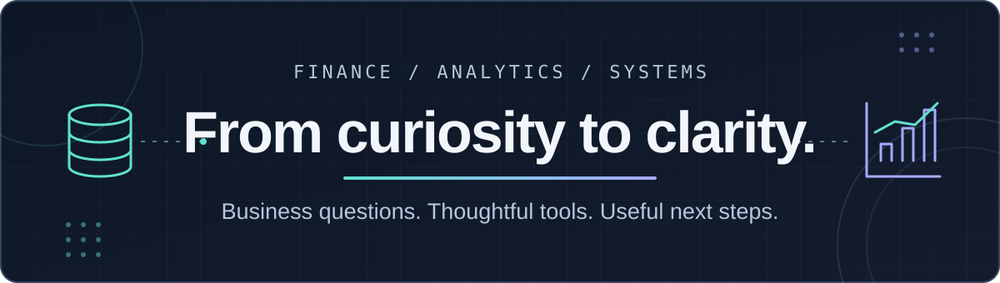
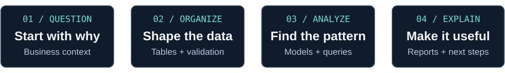

# Hi, I'm Cesar Sanchez 👋

**Data Analytics · Business Intelligence · Developing Data Engineering Skills**

Connecting finance, data, and practical tools to make the next decision clearer.

**[Explore my portfolio ↗](https://www.cesarsanchez1.me/)** &nbsp;·&nbsp; **[LinkedIn](https://www.linkedin.com/in/csanchez65/)** &nbsp;·&nbsp; **[Email](mailto:sanchezcesar106@gmail.com)**

## A little about me

I'm pursuing dual BBAs in **Finance** and **Business Analytics & Information Systems** at **Texas A&M University–Corpus Christi**, with graduation expected in **Spring 2027**.

I like taking something messy—a spreadsheet, an inventory list, or a business question—and giving it structure. What draws me to analytics is the connection between understanding the numbers and explaining what someone can do with them. I'm building that foundation through financial models, SQL and Python projects, databases, and dashboards.

Fitness and nutrition are also a big part of my story. My past coaching and campus-program work involved helping people build sustainable habits, organizing wellness activities, and training a small team to work independently. That people-first perspective is part of why I enjoy building practical tools like **NutriCook**.

## What I'm building & learning

- **Analytics & BI:** Turning business questions into financial models, SQL analysis, and clear reports.
- **Data engineering foundations:** Building my skills through reproducible Python/SQLite pipelines, dimensional modeling, and data validation.
- **Applied AI:** Refining NutriCook's recipe experience and reliability while keeping AI estimates and demo behavior clearly labeled.

  

## Explore my work

| Project | What you'll find |
| --- | --- |
| **[NorthStar Enterprise Analytics](https://github.com/Saner108/NorthStar-Enterprise-Analytics)** | A retail inventory-visibility pilot using Python, SQLite, a star schema, validation queries, and a dashboard. **Synthetic data, not real company performance or a production feed.** [Dashboard ↗](https://north-star-enterprise-analytics.vercel.app/) · [Findings](https://github.com/Saner108/NorthStar-Enterprise-Analytics/blob/main/06_Analysis/Phase5_Findings_Memo.md) |
| **[Excel Business Analytics Portfolio](https://github.com/Saner108/Excel-Business-Analytics-Portfolio)** | Financial calculations, capital budgeting, kitchen inventory, and personal-budget workbooks. Multiple versions are retained; see the repository for navigation. |
| **[NutriCook AI](https://github.com/Saner108/nutricook-ai)** | A React meal-planning app with Claude-powered recipes and optional Supabase/Stripe integrations. Nutrition is **AI-estimated, not independently verified**; sample/demo behavior depends on configuration, and live generation requires an API key. [Live app ↗](https://nutricook-ai-kappa.vercel.app/) |
| **[SLP Inventory Demo](https://github.com/Saner108/slp-inventory-demo)** | Equipment categories, models, and item records prepared in Excel/CSV for database coursework. **Sample data with generated or unverified serial/code values—not verified company inventory or a finished Access app.** |
| **[WaveWare Access Demo](https://github.com/Saner108/waveware-access-demo)** | A near-final representative database for animal diet, food inventory, weight, and reporting workflows. Selected employee names were replaced; **remaining data is not fully anonymized or synthetic**. Not a current aquarium system or animal-care guidance; native Access workflows were not re-tested after the sharing edit. |
| **[Python Projects](https://github.com/Saner108/Python-Projects/tree/Python_Based_Assignments)** | Three coursework scripts: a video rental calculator, a credit payment schedule, and a Lucky Sevens dice simulation. Code is on the **`Python_Based_Assignments`** branch. |

## My toolkit

| Area | Tools I use |
| --- | --- |
| **Analysis & reporting** | Excel · SQL · Python · SQLite |
| **Data & systems** | Microsoft Access · CSV preparation · Dimensional modeling · Validation queries |
| **Apps & AI-assisted development** | React · Vite · Vercel · Supabase · Claude / Claude API · ChatGPT |

These reflect tools used in my projects and workflow, not certifications or proficiency ratings.

## Let's connect

Interested in a project, want to compare notes, or see a place where finance and analytics overlap? I'd love to connect.

**[Portfolio](https://www.cesarsanchez1.me/)** · **[LinkedIn](https://www.linkedin.com/in/csanchez65/)** · **[Email](mailto:sanchezcesar106@gmail.com)**
